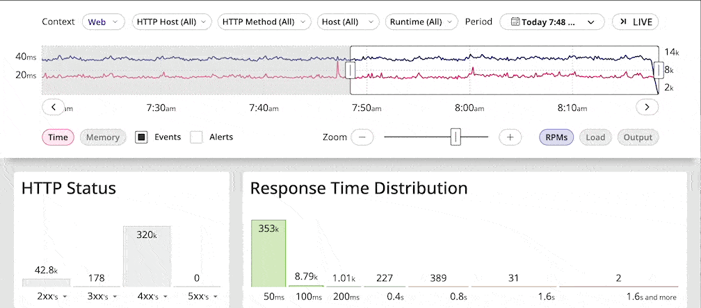
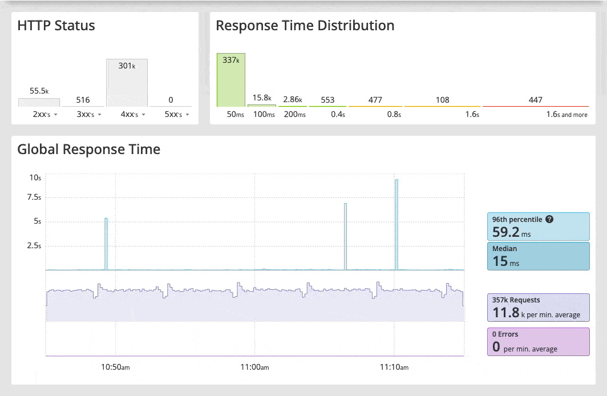
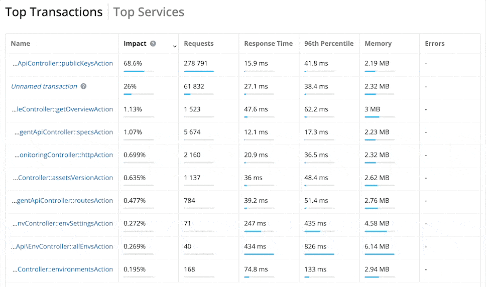
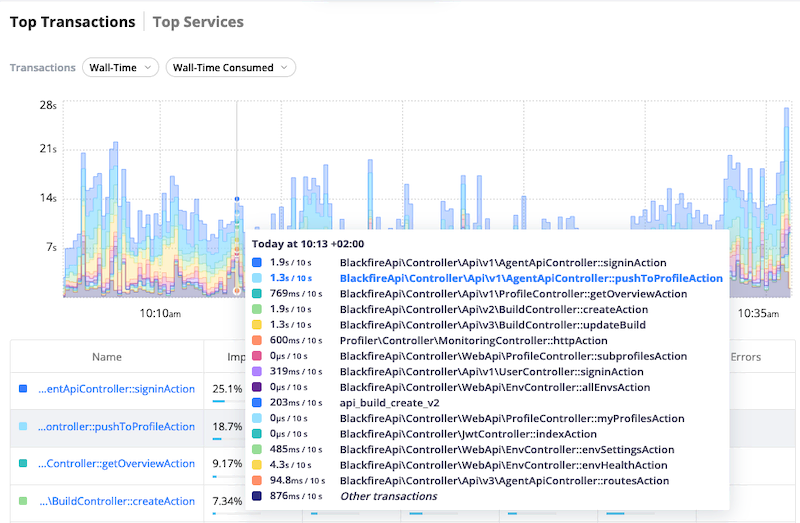

Filtering Transactions
=======================

.. include-twig:: `youtube-iframe`
    :title: introduction-to-blackfire
    :src: https://www.youtube-nocookie.com/embed/pf23gxQuMds?rel=0&showinfo=0&modestbranding=1&autoplay=0
    :width: 700px
    :height: 394px

You can filter HTTP Monitoring data by HTTP Host, HTTP method, Host, Runtime, and
:ref:`Application <monitoring_filtering_by_application>`.
You can use those filters individually or combined:

Each filter allows you to pick only some terms, or everything but some terms.

You can concomitantly filter monitoring data by HTTP status or response time by
clicking the respective graph. To reset the filter, click the graph again:

.. _monitoring_filtering_by_application:

Filtering by application
------------------------

When several applications report to the same environment, you can restrict the
Monitoring dashboard to one or more of them with the **Applications** filter,
located above the main graph.

Like the other filters, the **Applications** filter lets you select **Only**
some applications, or **All** applications except some. It combines with the
HTTP host, HTTP method, host, and runtime filters.

Transactions sent without an application name are grouped under **Default**.

.. note::

    The **Applications** filter appears only when the selected timeframe
    contains monitoring data with an application name.

Setting the application name
~~~~~~~~~~~~~~~~~~~~~~~~~~~~

The application name is supported by PHP Probe ``2026.4.1`` or later, and
Python SDK ``2026.4.0`` or later. Other runtimes and older versions report their
transactions under **Default**.

On Upsun, PHP and Python applications report their own name without any
configuration.

Elsewhere, set the application name for PHP with the ``blackfire.app_name`` INI
setting:

.. code-block:: ini

    blackfire.app_name = my-api

To set a different name per PHP-FPM pool, define the setting in the pool
configuration:

.. code-block:: ini

    php_admin_value[blackfire.app_name] = my-api

You can also set the ``BLACKFIRE_APP_NAME`` environment variable. For Python,
this is the only option. For PHP, the Probe reads ``BLACKFIRE_APP_NAME`` once,
when PHP starts. Set it in the environment of the PHP-FPM master process or of
the CLI command, for instance in a Docker image or a systemd unit.

.. caution::

    PHP-FPM ``env[BLACKFIRE_APP_NAME]`` pool directives have no effect: the
    Probe reads the environment before PHP-FPM applies them. Use
    ``php_admin_value[blackfire.app_name]`` instead.

Top Transactions
----------------

The Monitoring Dashboard displays the list of top transactions for the selected
timeframe. This list is primarily sorted by impact, representing the percentage
of time spent processing one transaction versus all the other ones.

A best practice is to optimize high impact transactions first.

You can also sort the top transactions list by number of requests, response-time,
96th percentile, memory, and errors.

To display the monitoring data related to a transaction, click the transaction name.

The :ref:`Top Services<top_services>` tabs displays the most impactful
:term:`spans ` for the whole environment.

Transaction Breakdown
----------------------

The transaction breakdown graph displays the evolution of the most impactful
transactions over time, for the selected timeframe and dimension. It provides
convenient contextualized information, helping you understand your application's
dynamics.
